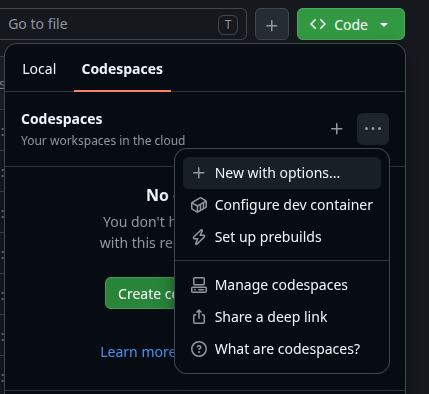

# Rahhal ADK (رحّال): build an Arabic travel agent with Google ADK, for free

<div dir="rtl">

«رحّال» مساعد ذكي لتخطيط الجانب اللوجستي للرحلات، وأول قالب رحلة فيه هو العمرة. بنبنيه خطوة بخطوة
مع برنامج «مسار» من جوجل، على مفتاح مجاني ومن غير بطاقة ائتمان.

</div>

Rahhal ADK is an Arabic travel-logistics assistant built with Google's
[Agent Development Kit (ADK)](https://google.github.io/adk-docs/) 2.14. Its first trip template is **Umrah**:
a trip with real logistics (two cities, elderly travellers, prayer times, a tight budget) and a clear boundary
(no religious rulings). It is a learning project, not a travel product or booking service. It follows **Masar (مسار)**, Google's Arabic
ADK learning program: one episode per Masar session, each a short "run and explain" video with a lesson here.

**The claim this repo proves:** you can follow Masar end to end with **zero cost and no credit card** (a GitHub
account and a free Google AI Studio key), on a **small model** (Gemini 3.5 Flash-Lite), **without Google Search**,
with almost everything **running on your machine** or in a free GitHub Codespace.

[](https://codespaces.new/aymanaboghonim/rahhal-adk)

## Episodes

| # | Episode | Masar session | Lesson | Tag | Video |
|---|---------|---------------|--------|-----|-------|
| 1 | Your first ADK agent with tools, on a free key | Foundation + 1. Empowering AI Agents with Tools | [lessons/ep01](lessons/ep01/) | [`ep01-tools`](https://github.com/aymanaboghonim/rahhal-adk/releases/tag/ep01-tools) | coming soon |
| 2 | Stateful ADK agents: Rahhal remembers your trip | 2. Stateful & Personalized Agents (Memory) | | `ep02-memory` | |
| 3 | ADK agents on a database with MCP Toolbox | 3. Multi-Agent Apps with MCP Toolbox for Databases | | `ep03-toolbox` | |
| 4 | Agent-to-agent with ADK: a currency agent over MCP & A2A | 4. Agent Interoperability with MCP & A2A | | `ep04-a2a` | |
| 5 | ADK workflow agents: a day-by-day Umrah plan | 5. Multi-Agent Workflow Patterns | | `ep05-workflows` | |
| ★ | Evaluating ADK agents, and dialect coverage | after the season | | `bonus-evals` | |

Each episode is a git tag: `git checkout ep01-tools` gives you exactly the code of episode 1. The `main` branch
always has the latest episode. Full plan: [docs/ROADMAP.md](docs/ROADMAP.md).

## Start here

### 1. Get a free Gemini API key (no billing)
1. Open [Google AI Studio → Projects](https://aistudio.google.com/projects) and click **Create a new project**.
2. On **API Keys**, click **Create API key**, name it, and choose the new project.
3. Check that **Billing Tier** says **Free tier**. Don't click **Set up billing**. Copy the key.

Step-by-step screenshots (Arabic): [lessons/setup.md](lessons/setup.md).

> [!WARNING]
> A project with billing enabled is on a paid tier and **is charged**. Never link billing to this project.

### 2a. Run it in GitHub Codespaces (recommended: nothing to install)
1. On this repo: **Code → Codespaces → … → New with options**. At the bottom, paste your key into
   `GOOGLE_API_KEY` (a Codespaces secret: it stays in your GitHub settings, never in the repo).
   The badge above also works; then add the key afterwards (see the `scripts/check.py` output).

   
2. Wait for the setup: it installs everything and runs the self-check.
3. In the terminal:
   ```bash
   uv run python scripts/check.py ep01
   uv run adk web --allow_origins http://localhost:8000
   ```
4. Open port **8000** from the **Ports** tab.

> [!WARNING]
> In a codespace, plain `uv run adk web` shows a blank page (`403 Forbidden` in the terminal). GitHub's port
> forwarding sends your browser's requests with the origin `http://localhost:8000`, and ADK blocks origins it can't
> match, to protect you from malicious websites. `--allow_origins http://localhost:8000` allows exactly that one.

The first `adk` command asks `Enable telemetry? [Y/n]`. Pressing Enter means **yes**; type `n` if you don't want
to share anonymous usage data with Google (`uv run adk telemetry disable` changes it later).

> [!NOTE]
> Personal GitHub Free accounts include 120 core-hours and 15 GB of Codespaces storage per month (about 60 hours
> on the default 2-core machine). If you have no payment method on GitHub, usage simply stops at the limit; nothing
> is charged. A codespace stops by itself after 30 idle minutes (GitHub's default); you can shorten that, and the
> 30-day auto-delete of stopped codespaces, in [your Codespaces settings](https://github.com/settings/codespaces).
> Stopped codespaces still use storage, so **delete** yours at the end of the series. A codespace is a cloud
> development environment, not a production server.

### 2b. Or run it on your machine (Linux, WSL, Windows, macOS)
1. Install [uv](https://docs.astral.sh/uv/getting-started/installation/), then:
   ```bash
   git clone https://github.com/aymanaboghonim/rahhal-adk.git
   cd rahhal-adk
   uv sync
   cp .env.example .env        # then paste your key into .env
   uv run python scripts/check.py ep01
   uv run adk web
   ```
2. Open <http://127.0.0.1:8000> (use `127.0.0.1`, not `localhost`).

**Arabic in `adk web` (optional):** ADK's web UI is left-to-right, so Arabic replies look misaligned, and ADK has no
option to change its style. The fix lives in your browser: install the [Stylus](https://github.com/openstyles/stylus)
extension (Chrome, Edge, Firefox), create a new style, paste
[docs/assets/adk-web-rtl.user.css](docs/assets/adk-web-rtl.user.css), and set "Applies to" as the comment at the top of
that file says. It works for local `adk web` and for the Codespaces URL.

## Free, and on your machine

| Runs locally (or in your codespace) | Goes to Google |
|-------------------------------------|----------------|
| the tools: currency (demo rates), hotels (fictional), prayer times (calculated) | each model request: your message, the instructions, and tool results |
| the fiqh filter, the data, the tests | |

- **Limits** (Gemini 3.5 Flash-Lite, free tier, read on the AI Studio rate-limit page on 2026-11-25):
  15 requests per minute, 500 per day. One message usually costs about 2 requests.
- **Privacy:** on the free tier, Google may use your prompts to improve its products. That's why all data
  here is fictional. Don't type personal data.
- **No Google Search:** the codelab's search tool needs a model with free search grounding, and none worked for
  a new free key when we tested (2026-11-23). The lesson explains it.
- **Evaluation:** offline tests and golden cases run on the free tier; ADK's Vertex AI-based metrics need billing,
  so we don't use them.
- Tested with google-adk 2.14.0. Terms and limits can change; check the dates above.

## What Rahhal won't do
Rahhal handles trip logistics only: budget, currency, hotels, prayer times, planning the days. It never books
anything. In the Umrah template it **never gives religious rulings (فتوى)**: it refers those questions to qualified scholars (أهل العلم), and official
bookings and permits to **Nusuk (نسك)**, the official platform. Hotels and exchange rates are
fictional demo data.

## Questions?
Ask in [Discussions → Q&A](../../discussions/categories/q-a) and include the output of
`uv run python scripts/check.py <episode>`. Never paste your API key. Contributions: [CONTRIBUTING.md](CONTRIBUTING.md).

## License and credits
Code: [Apache License 2.0](LICENSE). Lessons and documentation text: [CC BY 4.0](https://creativecommons.org/licenses/by/4.0/).
Parts are adapted from Google's "Building AI Agents with ADK" codelabs (see [NOTICE](NOTICE)).
Not affiliated with or endorsed by Google, the Masar program, or the Ministry of Hajj and Umrah / Nusuk.
