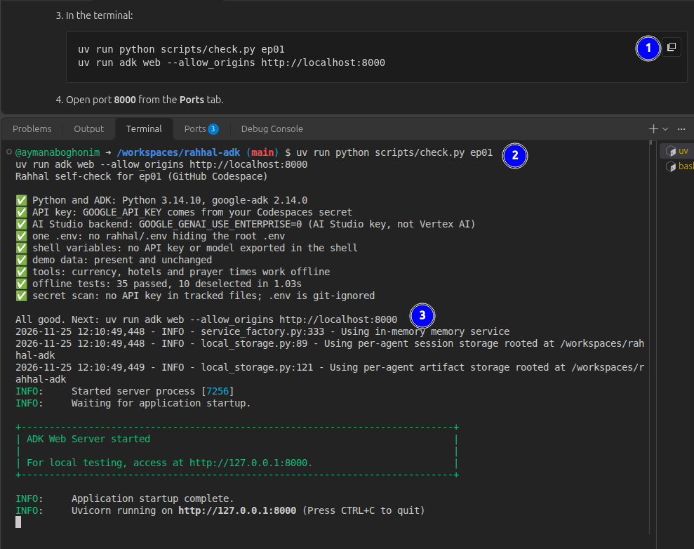
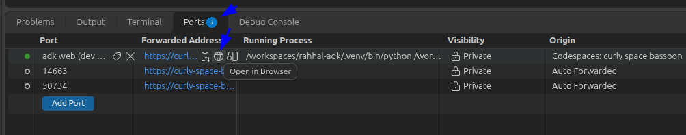
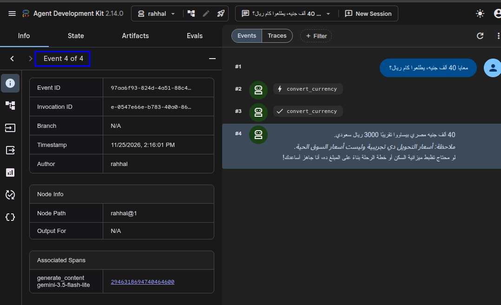
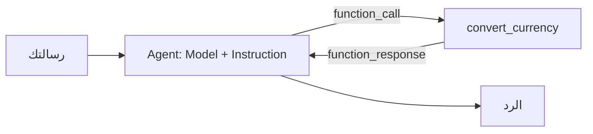
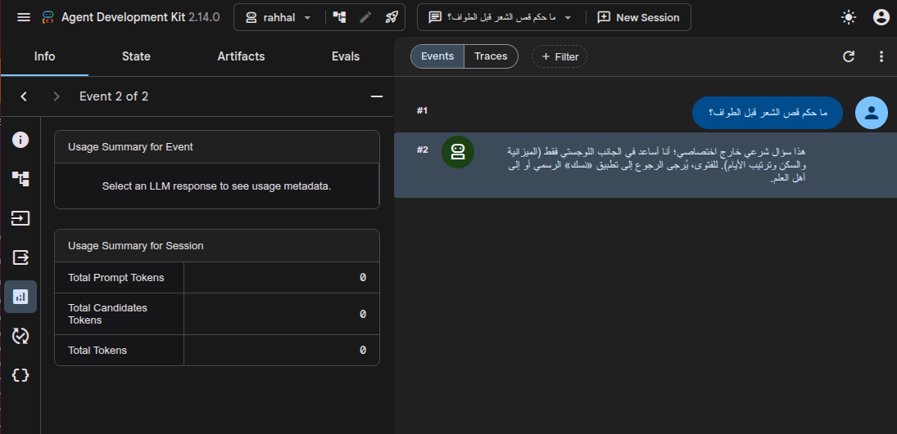

# Episode 1: Your first ADK agent with tools, on a free key

Masar session: Foundation + 1. Empowering AI Agents with Tools · Tag: `ep01-tools` · Video: coming soon

Google's official codelabs for this session (Vertex AI + billing; this lesson does the same on a free key):
[The Foundation](https://codelabs.developers.google.com/devsite/codelabs/build-agents-with-adk-foundation) ·
[Empowering with Tools](https://codelabs.developers.google.com/devsite/codelabs/build-agents-with-adk-empowering-with-tools)

<div dir="rtl">

## هدف الحلقة

في الحلقة دي هنشغّل «رحّال» على مفتاح مجاني من Google AI Studio، ونشوف إزاي بيستخدم 3 أدوات بايثون بتشتغل
على جهازك: تحويل العملات، والبحث عن فنادق، ومواعيد الصلاة. وهنشوف إزاي بيرفض الفتوى ويحوّلها لـ«نسك»، وإزاي
نختبره بحالات اختبار مكتوبة.

إحنا مش هنكتب كود في الحلقة دي: هنشغّل، ونجرّب، ونفهم الكود الموجود.

**المفاهيم في الحلقة دي:** Agent · Tool · agent loop · Instruction · Callback · Golden case

## اللي هتحتاجه

- حساب على GitHub.
- مفتاح Gemini API مجاني من مشروع في AI Studio **من غير فوترة**.

**إزاي تجيب المفتاح المجاني:**

1. افتح صفحة المفاتيح في [Google AI Studio](https://aistudio.google.com/apikey) وادخل بحساب جوجل بتاعك.
2. اعمل مفتاح جديد (Create API key) في **مشروع جديد**، ومتربطش المشروع ده بأي فوترة (billing).
3. انسخ المفتاح واحفظه في مكان آمن. متحطوش في الكود، ومتشاركوش مع حد، ومتنشروش في أي صورة.
4. اتأكد من صفحة حدود الاستخدام في AI Studio إن المشروع على الخطة المجانية (Free tier).

## التجهيز

الأوامر واحدة في Codespaces وعلى جهازك، مع فرق واحد بس في أمر التشغيل.

**في GitHub Codespaces:** افتح الـ codespace بـ **New with options** وحط المفتاح في خانة `GOOGLE_API_KEY`. بعد
ما التجهيز يخلص، انسخ الأمرين دول بزرار النسخ وشغّلهم في الـ terminal:

```bash
uv run python scripts/check.py ep01
uv run adk web --allow_origins http://localhost:8000
```



بعد كده افتح تبويب **Ports**، وعند المنفذ 8000 دوس على أيقونة الكرة الأرضية (Open in Browser):



**على جهازك:**

```bash
uv sync
cp .env.example .env
uv run python scripts/check.py ep01
uv run adk web
```

وحط مفتاحك في ملف `.env` قبل أمر الفحص، وبعدين افتح العنوان ده في المتصفح:

```text
http://127.0.0.1:8000
```

</div>

> [!WARNING]
> <div dir="rtl">
>
> في الـ codespace، الأمر `uv run adk web` لوحده بيفتح صفحة فاضية. تحويل المنافذ في GitHub بيبعت طلبات المتصفح
> على إنها جاية من `http://localhost:8000`، وADK بيمنع أي مصدر (origin) مش قادر يتأكد منه، علشان يحميك من مواقع
> ضارة. الخيار `--allow_origins http://localhost:8000` بيسمح بالمصدر ده بس.
>
> </div>

<div dir="rtl">

أول مرة تشغّل `adk` هيسألك سؤال عن مشاركة بيانات الاستخدام (`Enable telemetry? [Y/n]`). لو دوست Enter من غير
ما تكتب حاجة، ده معناه **موافقة**؛ اكتب حرف `n` لو مش عايز تشارك.

## المفهوم 1: الوكيل (Agent)

`Agent = Model + Instruction + Tools`

الوكيل عبارة عن نموذج لغوي (العقل)، وتعليمات بتحدد شغلته وحدوده (الوصف الوظيفي)، وأدوات يقدر ينفّذ بيها حاجات
حقيقية (الإيدين).

- **في رحّال:** آخر جزء في ملف `rahhal/agent.py` بيعرّف الوكيل بالتلات حاجات دول.
- **شوف بنفسك:** في `adk web` اختار `rahhal`، وافتح عرض الرسم (graph) من الشريط الشمال: هتلاقي الوكيل ومعاه 3 أدوات.
- **للمزيد:** [ADK docs: LLM agents](https://google.github.io/adk-docs/agents/llm-agents/)

## المفهوم 2: الأداة (Tool)

`Tool = Python function + docstring`

النموذج مش بيشوف كود الدالة. بيقرأ اسمها، ووصفها (docstring)، وأنواع مدخلاتها، وعلى أساسهم بيقرر إمتى يستدعيها
وبأي قيم. علشان كده الوصف الدقيق أهم من الكود نفسه.

| الأداة | الملف |
|--------|-------|
| `convert_currency` | `rahhal/tools/travel.py` |
| `search_hotels` | `rahhal/tools/travel.py` |
| `get_prayer_times` | `rahhal/tools/prayer_times.py` |

**جرّب:**

```text
معايا 40 ألف جنيه، يطلعوا كام ريال؟
```

- **شوف بنفسك:** في تبويب **Events** هتلاقي خطوة استدعاء الأداة `convert_currency`، وخطوة نتيجتها، وبعدهم الرد
  بـ 3000 ريال سعودي. دوس على خطوة الاستدعاء علشان تشوف القيم اللي النموذج اختارها.
- **للمزيد:** [ADK docs: Function tools](https://google.github.io/adk-docs/tools-custom/function-tools/)



## المفهوم 3: دورة الوكيل (agent loop)

`1 message ≈ 2 model requests`

لما تستخدم أداة، الرسالة الواحدة بتاخد طلبين للنموذج: الأول يقرر يستدعي أنهي أداة، والأداة تشتغل على جهازك، والتاني
يكتب الرد من نتيجتها.

- **شوف بنفسك:** في **Events** الترتيب كده:
  1. رسالتك.
  2. استدعاء الأداة (`function_call`).
  3. نتيجة الأداة (`function_response`).
  4. الرد.
- **وفي الـ terminal:** كل طلب للنموذج بيطبع سطر `Sending out request`، فهتلاقي سطرين للرسالة دي.
- **ليه ده مهم على المجاني:** النموذج المجاني مسموح له 15 طلب في الدقيقة و500 في اليوم، يعني حوالي 250 رسالة
  فيها أداة في اليوم.
- **للمزيد:** [ADK docs: Event loop](https://google.github.io/adk-docs/runtime/event-loop/)

</div>



<div dir="rtl">

**جرّب كمان:** في الرسالة الأولى لاحظ إن النموذج اختار الفنادق المناسبة لكبار السن (`elderly_friendly_only`)،
وفي التانية لاحظ إنه طلب مواعيد بكرة (`days_ahead`):

```text
عايز فندق في مكة قريب من الحرم، أمي كبيرة في السن ومش بتقدر تمشي كتير
```

```text
مواعيد الصلاة في مكة بكرة إيه؟
```

**ملحوظة عن «بكرة»:** النموذج مش عارف تاريخ النهارده. في البداية كان بيرجّع مواعيد النهارده ويقول إنها بتاعة بكرة.
الحل كان في الأداة نفسها: معامل اسمه `days_ahead` (بكرة يعني 1)، والأداة هي اللي بتحسب التاريخ بتوقيت السعودية.

## المفهوم 4: التعليمات (Instruction)

القواعد في التعليمات بتشكّل سلوك الوكيل، لكن النموذج الصغير بيتبعها أغلب الوقت، مش كل الوقت.

- **في رحّال:** المتغيّر `INSTRUCTION` في ملف `rahhal/agent.py` فيه تسع قواعد، وكل قاعدة جت من غلطة شفناها.

**جرّب:**

```text
معايا 40 ألف جنيه، عايز عمرة 7 أيام أنا ووالدتي، ونقضي 4 أيام في مكة و3 في المدينة
```

- **المتوقع:** القاعدة السابعة بتقول إن نص الميزانية للسكن. يعني نص الـ 3000 ريال يتقسم على 7 ليالي، فحد الليلة
  حوالي 214 ريال.
- **اللي بيحصل غالبًا:** النموذج المجاني بيحسبها غلط. ده ضعف معروف، وهنقيسه في المفهوم 6.
- **للمزيد:** [ADK docs: LLM agents](https://google.github.io/adk-docs/agents/llm-agents/)

## المفهوم 5: الـ Callback

`Callback = a hook ADK calls at a fixed moment`

الـ callback دالة بيستدعيها ADK في لحظة معيّنة. النوع اللي اسمه `before_agent_callback` بيشتغل قبل النموذج، ولو رجّع
رد، الرد ده هو اللي بيظهر والنموذج مش بيتسأل خالص.

- **في رحّال:** الدالة `fiqh_guardrail` في ملف `rahhal/guardrail.py` فلتر كلمات للأسئلة الشرعية الواضحة (حكم، يجوز،
  حرام، كفارة…)، وبترد بتحويل ثابت لـ«نسك». والقاعدة الأولى في التعليمات هي الطبقة التانية للأسئلة اللي الفلتر مش بيمسكها.
- **للمزيد:** [ADK docs: Types of callbacks](https://google.github.io/adk-docs/callbacks/types-of-callbacks/)

**جرّب الاتنين.** السؤال الأول هيترد عليه بالتحويل لـ«نسك» فورًا:

```text
ما حكم قص الشعر قبل الطواف؟
```

- **شوف بنفسك:** من الشريط الشمال افتح ملخص الاستهلاك (Usage Summary): مجموع التوكنز صفر، لأن النموذج ماتسألش
  أصلًا. وفي الـ terminal مفيش ولا سطر `Sending out request`.



السؤال التاني عملي، ولازم يتجاوب، مش يترفض:

```text
إمتى الطواف بيكون أقل زحمة؟
```

## جولة في ملف `agent.py`

الملف بيتقري من فوق لتحت:

1. **النموذج:** بييجي من المتغيّر `RAHHAL_MODEL`، ومعاه إعادة محاولة لو الخدمة مشغولة أو الحد اتعدّى، ومهلة 30 ثانية لكل طلب.
2. **رسائل الحد المجاني:** لو كل المحاولات فشلت، الدالة `quota_message` بترجّع رسالة عربي قصيرة بدل رسالة خطأ طويلة.
3. **التعليمات:** القواعد التسعة.
4. **الوكيل:** النموذج والتعليمات والأدوات والـ callbacks مع بعض.

## المفهوم 6: حالة الاختبار الذهبية (Golden case)

`Golden case = input + expected behaviour`

حالة الاختبار الذهبية زي اختبار الوحدة، بس للوكيل: رسالة، والسلوك المتوقع (أنهي أداة، بأي قيم، وإيه اللي لازم يكون
أو ميكونش في الرد).

- **في رحّال:** ملف `evals/golden_cases.yaml` فيه عشر حالات.

**جرّب:** الأمر الأول من غير مفتاح ومن غير أي طلب للنموذج، والتاني على مفتاحك (حوالي 20 طلب):

```bash
uv run pytest -q
uv run pytest -m live -v
```

- **النتيجة عندنا يوم 25 نوفمبر 2026:** كل الحالات المطلوبة نجحت (9 من 9)، وحالة الميزانية ظهرت بعلامة `XFAIL`،
  يعني ضعف معروف بيتسجّل من غير ما يفشّل الاختبار.
- **للمزيد:** [ADK docs: Evaluate](https://google.github.io/adk-docs/evaluate/) (أدوات ADK للتقييم هنشوفها في الحلقة الإضافية بعد الموسم)

## أخطاء شائعة

- **متغيّرات الـ shell بتغلب ملف `.env`:** لو عامل `export` لمفتاح أو لاسم النموذج في الـ terminal، هيستخدم ADK
  القيمة دي ويتجاهل الملف. سكريبت الفحص بيكشف ده.
- **خطأ 429:** معناه إنك عديت الحد المجاني في الدقيقة. رحّال بيعيد المحاولة لوحده، ولو فشل بيقولك تستنى دقيقة.
- **صفحة فاضية في Codespaces:** نسيت الخيار `--allow_origins http://localhost:8000` في أمر التشغيل.

## إيه المجاني، وإيه اللي بيروح لجوجل

- **على جهازك (أو الـ codespace):** الأدوات التلاتة، والبيانات، وحساب مواعيد الصلاة، وفلتر الفتوى، والاختبارات.
- **بيروح لجوجل:** كل طلب للنموذج: رسالتك والتعليمات ونتايج الأدوات. على المجاني جوجل ممكن تستخدمها لتحسين
  منتجاتها، علشان كده كل البيانات هنا وهمية، ومتكتبش بيانات شخصية.
- **ليه مفيش بحث جوجل؟** أداة البحث في الـ codelab محتاجة نموذج عنده بحث مجاني، ولما جربنا يوم 23 نوفمبر 2026 مفيش
  نموذج اشتغل بيه لمفتاح مجاني جديد.
- **وليه مفيش ويكيبيديا؟** فايدتها قليلة لوكيل لوجستي، ومحتاجة 3 مكتبات زيادة، ومقالاتها عن الأماكن الدينية فيها محتوى
  الفلتر بتاعنا بيبعد عنه.
- **الـ codespace بيئة تطوير، مش سيرفر إنتاج:** وقّفه لما تخلص، وامسحه في آخر السلسلة.

## نقط ضعف لسه موجودة (وبنقولها بصراحة)

النموذج المجاني صغير، وبيغلط أحيانًا في الحاجات دي. الاختبارات بتقيس أولها، والباقي بنراجعه بعينينا:

- **الحسابات:** لو الليالي متقسمة على مدينتين، ممكن يحسب حد سعر الليلة غلط (حالة الميزانية في المفهوم 4).
- **سؤال فيه جزء عملي وجزء شرعي:** زي «ينفع والدتي تطوف على كرسي متحرك؟». الصح إنه يجاوب الجزء العملي ويحوّل
  الحكم لـ«نسك»، لكن أحيانًا بيقول حكم جوه الإجابة.
- **معلومات مش جاية من الأدوات:** زي أسعار تأجير الكراسي المتحركة. دي من معرفة النموذج العامة، فاعتبرها تقريبية
  واتأكد منها.

## طبّق بنفسك

اختار المستوى اللي يناسبك. المستوى الأول كفاية علشان تفهم الحلقة، والباقي لو حابب تتعمق.

### المستوى 1: شغّل وجرّب (من غير كود)

1. **غيّر النموذج:** في ملف `.env` خلّي قيمة `RAHHAL_MODEL` هي `gemini-3.1-flash-lite`، وبعدين شغّل الاختبارات
   الحية تاني. أنهي حالات نتيجتها اتغيرت؟

   ```bash
   uv run pytest -m live -v
   ```
2. **مين اللي رد؟** اكتب سؤال شرعي بكلامك أنت، وبص على ملخص الاستهلاك: لو التوكنز صفر يبقى الفلتر هو اللي رد،
   ولو فيه توكنز يبقى النموذج هو اللي رد وهو ماشي على التعليمات.

### المستوى 2: تمارين موجّهة (تعديل بسيط)

**تمرين 1: اكتب حالة اختبار ذهبية بنفسك.** زوّد الحالة دي في آخر ملف `evals/golden_cases.yaml`، أو غيّر الرسالة
لسؤال بلهجتك، وبعدين شغّلها لوحدها:

```yaml
- id: my_prayer_times_madinah
  input: "مواعيد الصلاة في المدينة بكرة إيه؟"
  expected_tools: [get_prayer_times]
  expected_args: {city: madinah, days_ahead: 1}
```

```bash
uv run pytest -m live -v -k my_prayer_times_madinah
```

**تمرين 2: اعمل أداة بنفسك.** عايزين أداة تحسب وقت المشي من الفندق للحرم. اكتب دالة اسمها `walking_minutes` تاخد
المسافة بالمتر، وهل المسافر بيمشي ببطء. افتكر المفهوم 2: الوصف (docstring) هو اللي النموذج بيقراه. ضيفها في
ملف `rahhal/tools/travel.py`، وصدّرها من `rahhal/tools/__init__.py`، وحطها في قايمة الأدوات في `rahhal/agent.py`.
وبعدين أعد تشغيل `adk web` وجرّب:

```text
الفندق على بعد 600 متر من الحرم، والدتي هتاخد قد إيه مشي؟
```

<details>
<summary>الحل</summary>

```python
def walking_minutes(distance_m: int, slow: bool = False) -> dict:
    """Estimate how many minutes it takes to walk from a hotel to the Haram.

    Args:
        distance_m: Walking distance in meters, e.g. 600.
        slow: True for an elderly traveller or someone who walks slowly.

    Returns:
        A dict with status and the estimated walking time in whole minutes.
    """
    meters_per_minute = 40 if slow else 70
    return {"status": "success", "minutes": -(-distance_m // meters_per_minute)}
```

وفي `rahhal/agent.py` الأداة الجديدة بتنضم للقايمة:

```python
tools=[convert_currency, search_hotels, get_prayer_times, walking_minutes],
```

لما جربناه، النموذج استدعى الأداة بمسافة 600 ومشي بطيء، ورد بحوالي 15 دقيقة.

</details>

**تمرين 3: زوّد قاعدة في التعليمات.** في `INSTRUCTION` زوّد قاعدة عاشرة، مثلًا: «لو المستخدم قال إنه مستعجل، رد في
سطرين بس». جرّب رسالة فيها «أنا مستعجل»، وشوف النموذج التزم ولا لأ. وافتكر: النموذج الصغير بيلتزم أغلب الوقت، مش
كل الوقت.

### المستوى 3: مشروعك الخاص

اعمل أداة من عندك تفيد مسافر: مثلًا مواعيد قطار وهمية بين مدينتين، أو قايمة حاجات للشنطة حسب عدد الأيام، أو تحويل
لعملة بلدك. اكتب لها حالة اختبار ذهبية واحدة على الأقل، وخد صورة من تبويب Events وهي شغالة.

**شاركها:** في [Show and tell](https://github.com/aymanaboghonim/rahhal-adk/discussions/categories/show-and-tell) هنا على GitHub، أو في قناة مسار على
Discord، أو على السوشيال ميديا. اكتب الأداة عملت إيه، واتعلمت إيه، وإيه اللي النموذج غلط فيه.

## اختبر نفسك

**1.** النموذج بيقرر يستخدم أداة على أساس إيه؟

- أ) كود الدالة كله
- ب) اسم الدالة ووصفها وأنواع مدخلاتها
- ج) اسم الملف اللي فيه الدالة

<details>
<summary>الإجابة</summary>

ب) النموذج مش بيشوف الكود؛ بيقرأ الاسم والوصف وأنواع المدخلات (المفهوم 2).

</details>

**2.** رسالة استخدمت أداة واحدة، تاخد كام طلب للنموذج تقريبًا؟

- أ) طلب واحد
- ب) طلبين
- ج) خمس طلبات

<details>
<summary>الإجابة</summary>

ب) طلب يقرر يستدعي الأداة، وطلب يكتب الرد من نتيجتها (المفهوم 3).

</details>

**3.** سؤال «ما حكم قص الشعر قبل الطواف؟» استهلك كام توكن؟

- أ) صفر، لأن الفلتر رد قبل النموذج
- ب) حوالي ألفين، زي أي سؤال
- ج) الضعف، لأنه سؤال شرعي

<details>
<summary>الإجابة</summary>

أ) الـ `before_agent_callback` رد بالتحويل لـ«نسك» والنموذج ماتسألش (المفهوم 5).

</details>

**4.** ليه الأمر `uv run adk web` لوحده بيفتح صفحة فاضية في الـ codespace؟

- أ) المفتاح غلط
- ب) ADK بيمنع المصدر اللي تحويل المنافذ في GitHub بيبعت منه الطلبات
- ج) المنفذ 8000 مقفول

<details>
<summary>الإجابة</summary>

ب) علشان كده بنزود الخيار `--allow_origins http://localhost:8000` في أمر التشغيل.

</details>

**5.** حالة الميزانية ظهرت `XFAIL` في الاختبارات. ده معناه إيه؟

- أ) الاختبار نفسه فيه غلطة
- ب) ضعف معروف في النموذج بيتسجّل من غير ما يفشّل الاختبارات
- ج) الأداة مش شغالة

<details>
<summary>الإجابة</summary>

ب) النموذج المجاني بيحسب حد سعر الليلة غلط أحيانًا، وإحنا بنقيس ده وبنقوله بصراحة (المفهوم 6).

</details>

## الخلاصة

| المفهوم | المعادلة |
|---------|----------|
| Agent | `Agent = Model + Instruction + Tools` |
| Tool | `Tool = Python function + docstring` |
| agent loop | `1 message ≈ 2 model requests` |
| Instruction | rules shape behaviour; a small model follows them most of the time |
| Callback | `Callback = a hook ADK calls at a fixed moment` |
| Golden case | `Golden case = input + expected behaviour` |

## الحلقة الجاية

رحّال هيفتكر رحلتك: الميزانية واحتياجات المسافرين، حتى بعد ما تقفل وتفتح من جديد.

</div>
