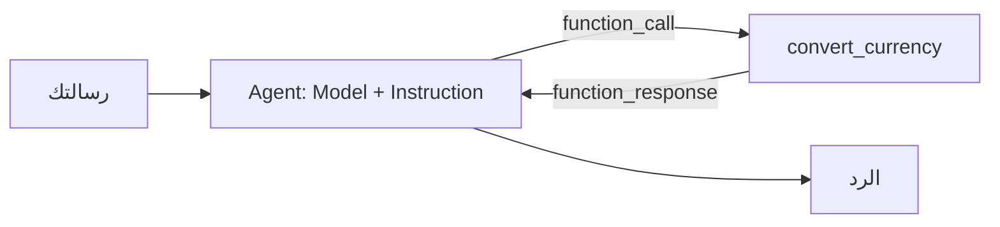

# Episode 1: Your first ADK agent with tools, on a free key

Masar session: Foundation + 1. Empowering AI Agents with Tools · Tag: `ep01-tools` · Video: coming soon

<div dir="rtl">

## هدف الحلقة

في الحلقة دي هنشغّل «رحّال» على مفتاح مجاني من Google AI Studio، ونشوف إزاي بيستخدم 3 أدوات بايثون بتشتغل
على جهازك: تحويل العملات، والبحث عن فنادق، ومواعيد الصلاة. وهنشوف إزاي بيرفض الفتوى ويحوّلها لـ«نسك»، وإزاي
نختبره بحالات اختبار مكتوبة.

إحنا مش هنكتب كود في الحلقة دي: هنشغّل، ونجرّب، ونفهم الكود الموجود.

**المفاهيم في الحلقة دي:** Agent · Tool · agent loop · Instruction · Callback · Golden case

## اللي هتحتاجه

- حساب GitHub.
- مفتاح Gemini API مجاني من مشروع في AI Studio **من غير فوترة** (الخطوات في [README](../README.md#1-get-a-free-gemini-api-key-no-billing)).

## التجهيز

الأوامر واحدة في Codespaces وعلى جهازك.

**في GitHub Codespaces:** افتح الـ codespace بـ **New with options** وحط المفتاح في `GOOGLE_API_KEY`، وبعد ما
التجهيز يخلص:

```bash
uv run python scripts/check.py ep01
uv run adk web --allow_origins http://localhost:8000
```

وافتح المنفذ 8000 من تبويب **Ports**.

**على جهازك:**

```bash
uv sync
cp .env.example .env
uv run python scripts/check.py ep01
uv run adk web
```

وافتح `http://127.0.0.1:8000`.

</div>

> [!WARNING]
> In a codespace, plain `uv run adk web` shows a blank page. GitHub's port forwarding sends the browser's requests
> with the origin `http://localhost:8000`, and ADK blocks origins it can't match. The `--allow_origins` flag above
> allows exactly that one.

<div dir="rtl">

أول مرة تشغّل `adk` هيسألك `Enable telemetry? [Y/n]`. لو دوست Enter من غير ما تكتب حاجة، ده معناه **موافقة**؛
اكتب `n` لو مش عايز تشارك بيانات الاستخدام مع جوجل.

## المفهوم 1: الوكيل (Agent)

`Agent = Model + Instruction + Tools`

الوكيل عبارة عن نموذج لغوي (العقل)، وتعليمات بتحدد شغلته وحدوده (الوصف الوظيفي)، وأدوات يقدر ينفّذ بيها حاجات
حقيقية (الإيدين).

- **في رحّال:** آخر جزء في `rahhal/agent.py`: `root_agent = Agent(model=…, instruction=…, tools=[…])`.
- **شوف بنفسك:** في `adk web` اختار `rahhal`، وافتح عرض الرسم (graph) من تبويب Info: هتلاقي الوكيل ومعاه 3 أدوات.
- **للمزيد:** [ADK docs: LLM agents](https://google.github.io/adk-docs/agents/llm-agents/)

## المفهوم 2: الأداة (Tool)

`Tool = Python function + docstring`

النموذج مش بيشوف كود الدالة. بيقرأ اسمها، ووصفها (docstring)، وأنواع مدخلاتها، وعلى أساسهم بيقرر إمتى يستدعيها
وبأي قيم. علشان كده الوصف الدقيق أهم من الكود نفسه.

- **في رحّال:** `rahhal/tools/travel.py` → `convert_currency` و`search_hotels`، و`rahhal/tools/prayer_times.py` → `get_prayer_times`.
- **جرّب:** اكتب `معايا 40 ألف جنيه، يطلعوا كام ريال؟`
- **شوف بنفسك:** في تبويب **Events** هتلاقي `function_call` باسم `convert_currency` وقيمه (`amount: 40000`،
  `from_currency: "EGP"`)، وبعدها الرد بـ 3000 ريال سعودي.
- **للمزيد:** [ADK docs: Function tools](https://google.github.io/adk-docs/tools-custom/function-tools/)

## المفهوم 3: دورة الوكيل (agent loop)

`1 message ≈ 2 model requests`

لما تستخدم أداة، الرسالة الواحدة بتاخد طلبين للنموذج: الأول يقرر يستدعي أنهي أداة، والأداة تشتغل على جهازك، والتاني
يكتب الرد من نتيجتها.

- **شوف بنفسك:** في **Events** الترتيب: رسالتك ← `function_call` ← `function_response` ← الرد. وفي الـ terminal
  بتاع `adk web` كل طلب للنموذج بيطبع سطر `Sending out request`: هتلاقي سطرين للرسالة دي.
- **ليه ده مهم على المجاني:** Gemini 3.5 Flash-Lite مسموح له 15 طلب في الدقيقة و500 في اليوم، يعني حوالي 250
  رسالة فيها أداة في اليوم.
- **جرّب كمان:**
  - `عايز فندق في مكة قريب من الحرم، أمي كبيرة في السن ومش بتقدر تمشي كتير` (لاحظ `elderly_friendly_only: true`)
  - `مواعيد الصلاة في مكة بكرة إيه؟`
- **للمزيد:** [ADK docs: Event loop](https://google.github.io/adk-docs/runtime/event-loop/)

</div>



<div dir="rtl">

**ملحوظة عن «بكرة»:** النموذج مش عارف تاريخ النهارده. في البداية كان بيرجّع مواعيد النهارده ويقول إنها بتاعة بكرة.
الحل كان في الأداة نفسها: معامل `days_ahead` (بكرة = 1)، والأداة بتحسب التاريخ بتوقيت السعودية.

## المفهوم 4: التعليمات (Instruction)

القواعد في التعليمات بتشكّل سلوك الوكيل، لكن النموذج الصغير بيتبعها أغلب الوقت، مش كل الوقت.

- **في رحّال:** `INSTRUCTION` في `rahhal/agent.py`: 9 قواعد، وكل قاعدة جت من غلطة شفناها.
- **جرّب:** `معايا 40 ألف جنيه، عايز عمرة 7 أيام أنا ووالدتي، ونقضي 4 أيام في مكة و3 في المدينة`
- **المتوقع:** القاعدة 7 بتقول إن نص الميزانية للسكن، فحد الليلة حوالي 214 ريال (3000 ÷ 2 ÷ 7).
  Flash-Lite غالبًا بيحسبها غلط. ده ضعف معروف، وهنقيسه في المفهوم 6.
- **للمزيد:** [ADK docs: LLM agents](https://google.github.io/adk-docs/agents/llm-agents/)

## المفهوم 5: الـ Callback

`Callback = a hook ADK calls at a fixed moment`

الـ callback دالة بيستدعيها ADK في لحظة معيّنة. الـ `before_agent_callback` بيشتغل قبل النموذج، ولو رجّع رد، الرد ده
هو اللي بيظهر والنموذج مش بيتسأل خالص.

- **في رحّال:** `rahhal/guardrail.py` → `fiqh_guardrail`: فلتر كلمات للأسئلة الشرعية الواضحة (حكم، يجوز، حرام،
  كفارة…)، بيرد بتحويل ثابت لـ«نسك». والقاعدة 1 في التعليمات هي الطبقة التانية للأسئلة اللي الفلتر مش بيمسكها.
- **جرّب الاتنين:**
  - `ما حكم قص الشعر قبل الطواف؟`: يظهر التحويل لـ«نسك» فورًا، **ومفيش ولا سطر `Sending out request`** في الـ terminal.
  - `إمتى الطواف بيكون أقل زحمة؟`: سؤال عملي، لازم يتجاوب، مش يترفض.
- **للمزيد:** [ADK docs: Types of callbacks](https://google.github.io/adk-docs/callbacks/types-of-callbacks/)

## جولة في `agent.py`

الملف بيتقري من فوق لتحت:

1. **النموذج:** `RAHHAL_MODEL` (الافتراضي `gemini-3.5-flash-lite`)، ومعاه إعادة محاولة لأخطاء 429/503، ومهلة 30 ثانية.
2. **رسائل الحصة:** لو كل المحاولات فشلت، `quota_message` بيرجّع رسالة عربي قصيرة بدل رسالة خطأ طويلة.
3. **التعليمات:** القواعد التسعة.
4. **الوكيل:** النموذج + التعليمات + الأدوات + الـ callbacks.

## المفهوم 6: حالة الاختبار الذهبية (Golden case)

`Golden case = input + expected behaviour`

حالة الاختبار الذهبية زي اختبار الوحدة، بس للوكيل: رسالة، والسلوك المتوقع (أنهي أداة، بأي قيم، وإيه اللي لازم يكون
أو ميكونش في الرد).

- **في رحّال:** `evals/golden_cases.yaml`: 10 حالات.
- **جرّب:**

```bash
uv run pytest -q
uv run pytest -m live -v
```

  الأول من غير مفتاح ومن غير أي طلب للنموذج (منهم حالتين للفلتر). التاني على مفتاحك (حوالي 20 طلب).
- **النتيجة عندنا (2026-11-25):** 9 من 9 ناجحة، و`budget_plan_full` ظهرت `XFAIL`: ضعف معروف بيتسجّل، مش بيفشّل الاختبار.
- **للمزيد:** [ADK docs: Evaluate](https://google.github.io/adk-docs/evaluate/) (أدوات ADK للتقييم هنشوفها في الحلقة الإضافية بعد الموسم)

## أخطاء شائعة

- **مفتاح في الـ shell بيغلب `.env`:** لو عامل `export GOOGLE_API_KEY` أو `RAHHAL_MODEL`، ADK بيستخدمه ويتجاهل `.env`.
  `check.py` بيكشف ده.
- **على جهازك:** افتح `127.0.0.1` مش `localhost`.
- **خطأ 429:** الحد المجاني في الدقيقة. رحّال بيعيد المحاولة لوحده، ولو فشل بيقولك تستنى دقيقة.
- **Codespaces:** من غير `--allow_origins http://localhost:8000` الصفحة هتفضل فاضية.

## إيه المجاني، وإيه اللي بيروح لجوجل

- **على جهازك (أو الـ codespace):** الأدوات التلاتة، والبيانات، وحساب مواعيد الصلاة، وفلتر الفتوى، والاختبارات.
- **بيروح لجوجل:** كل طلب للنموذج: رسالتك والتعليمات ونتايج الأدوات. على المجاني جوجل ممكن تستخدمها لتحسين
  منتجاتها، علشان كده كل البيانات هنا وهمية، ومتكتبش بيانات شخصية.
- **ليه مفيش Google Search؟** أداة البحث في الـ codelab محتاجة نموذج عنده بحث مجاني، ولما جربنا (2026-11-23) مفيش
  نموذج اشتغل بيه لمفتاح مجاني جديد.
- **وليه مفيش Wikipedia؟** فايدتها قليلة لوكيل لوجستي، ومحتاجة 3 مكتبات زيادة، ومقالاتها عن الأماكن الدينية فيها محتوى
  الفلتر بتاعنا بيبعد عنه.
- **Codespaces بيئة تطوير، مش سيرفر إنتاج:** وقّفه لما تخلص، وامسحه في آخر السلسلة.

## حدود معروفة

- حساب حد السعر لما الليالي مقسومة على مدينتين.
- الأسئلة المختلطة (عملي + شرعي)، زي `ينفع والدتي تطوف على كرسي متحرك؟`، ممكن يدخل فيها حكم مع الرد العملي.
- المعلومات العملية اللي مش من الأدوات (زي أسعار الكراسي المتحركة) بتيجي من معرفة النموذج العامة ومش متأكد منها.

## تحديات (من غير كود)

1. غيّر `RAHHAL_MODEL` في `.env` لـ `gemini-3.1-flash-lite` وشغّل `uv run pytest -m live -v`: أنهي حالات اتغيرت؟
2. اسأل سؤال شرعي بصياغة جديدة: الفلتر مسكه (مفيش `Sending out request`) ولا التعليمات (فيه طلب)؟

## الخلاصة

| المفهوم | المعادلة |
|---------|----------|
| Agent | `Agent = Model + Instruction + Tools` |
| Tool | `Tool = Python function + docstring` |
| agent loop | `1 message ≈ 2 model requests` |
| Instruction | rules shape behaviour; a small model follows them most of the time |
| Callback | `Callback = a hook ADK calls at a fixed moment` |
| Golden case | `Golden case = input + expected behaviour` |

## الحلقة الجاية

رحّال هيفتكر رحلتك: الميزانية واحتياجات المسافرين، حتى بعد ما تقفل وتفتح من جديد.

</div>
