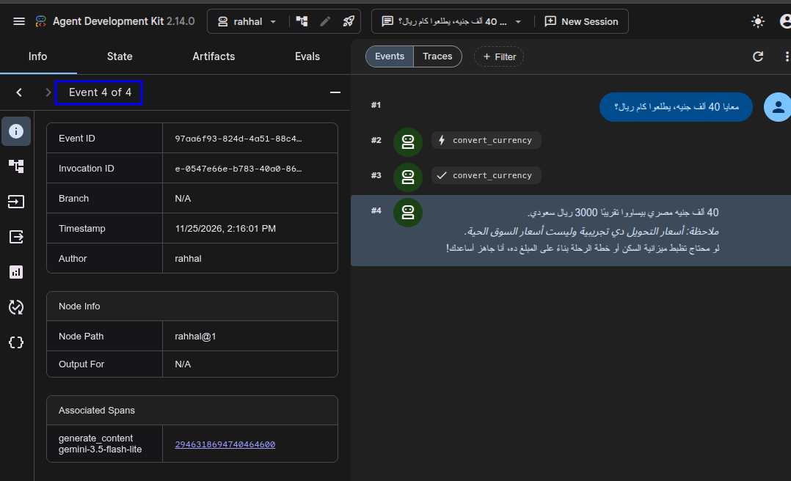
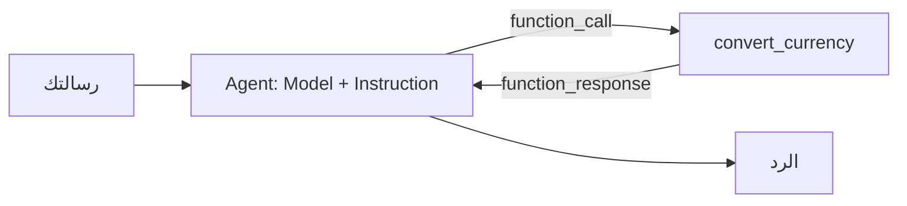
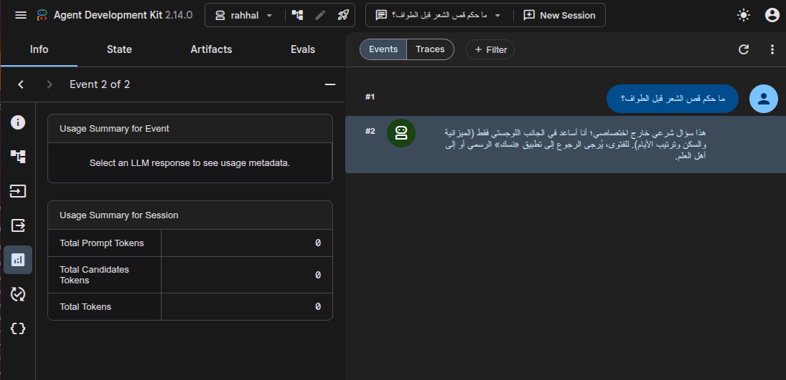

# Episode 1 · Concepts and try it

[Episode 1](README.md) → **Concepts** → [Practice](practice.md)

<div dir="rtl">

قبل ما تبدأ، لازم يكون رحّال شغّال عندك: شوف [التجهيز](../setup.md).

## المفهوم 1: الوكيل (Agent)

`Agent = Model + Instruction + Tools`

الوكيل عبارة عن نموذج لغوي (العقل)، وتعليمات بتحدد شغلته وحدوده (الوصف الوظيفي)، وأدوات يقدر ينفّذ بيها حاجات
حقيقية (الإيدين).

- **في رحّال:** آخر جزء في ملف `rahhal/agent.py` بيعرّف الوكيل بالتلات حاجات دول.
- **شوف بنفسك:** في `adk web` اختار `rahhal`، وافتح عرض الرسم (graph) من الشريط الشمال: هتلاقي الوكيل ومعاه 3 أدوات.
- **للمزيد:** [ADK docs: LLM agents](https://google.github.io/adk-docs/agents/llm-agents/)

## المفهوم 2: الأداة (Tool)

`Tool = Python function + docstring`

النموذج مش بيشوف كود الدالة. بيقرأ اسمها، ووصفها (docstring)، وأنواع مدخلاتها، وعلى أساسهم بيقرر إمتى يستدعيها
وبأي قيم. علشان كده الوصف الدقيق أهم من الكود نفسه.

| الأداة | الملف |
|--------|-------|
| `convert_currency` | `rahhal/tools/travel.py` |
| `search_hotels` | `rahhal/tools/travel.py` |
| `get_prayer_times` | `rahhal/tools/prayer_times.py` |

**جرّب:**

```text
معايا 40 ألف جنيه، يطلعوا كام ريال؟
```

- **شوف بنفسك:** في تبويب **Events** هتلاقي خطوة استدعاء الأداة `convert_currency`، وخطوة نتيجتها، وبعدهم الرد
  بـ 3000 ريال سعودي. دوس على خطوة الاستدعاء علشان تشوف القيم اللي النموذج اختارها.
- **للمزيد:** [ADK docs: Function tools](https://google.github.io/adk-docs/tools-custom/function-tools/)



## المفهوم 3: دورة الوكيل (agent loop)

`1 message ≈ 2 model requests`

لما تستخدم أداة، الرسالة الواحدة بتاخد طلبين للنموذج: الأول يقرر يستدعي أنهي أداة، والأداة تشتغل على جهازك، والتاني
يكتب الرد من نتيجتها.

- **شوف بنفسك:** في **Events** الترتيب كده:
  1. رسالتك.
  2. استدعاء الأداة (`function_call`).
  3. نتيجة الأداة (`function_response`).
  4. الرد.
- **وفي الـ terminal:** كل طلب للنموذج بيطبع سطر `Sending out request`، فهتلاقي سطرين للرسالة دي.
- **ليه ده مهم على المجاني:** النموذج المجاني مسموح له 15 طلب في الدقيقة و500 في اليوم، يعني حوالي 250 رسالة
  فيها أداة في اليوم.
- **للمزيد:** [ADK docs: Event loop](https://google.github.io/adk-docs/runtime/event-loop/)

</div>



<div dir="rtl">

**جرّب كمان:** في الرسالة الأولى لاحظ إن النموذج اختار الفنادق المناسبة لكبار السن (`elderly_friendly_only`)،
وفي التانية لاحظ إنه طلب مواعيد بكرة (`days_ahead`):

```text
عايز فندق في مكة قريب من الحرم، أمي كبيرة في السن ومش بتقدر تمشي كتير
```

```text
مواعيد الصلاة في مكة بكرة إيه؟
```

**ملحوظة عن «بكرة»:** النموذج مش عارف تاريخ النهارده. في البداية كان بيرجّع مواعيد النهارده ويقول إنها بتاعة بكرة.
الحل كان في الأداة نفسها: معامل اسمه `days_ahead` (بكرة يعني 1)، والأداة هي اللي بتحسب التاريخ بتوقيت السعودية.

## المفهوم 4: التعليمات (Instruction)

القواعد في التعليمات بتشكّل سلوك الوكيل، لكن النموذج الصغير بيتبعها أغلب الوقت، مش كل الوقت.

- **في رحّال:** المتغيّر `INSTRUCTION` في ملف `rahhal/agent.py` فيه تسع قواعد، وكل قاعدة جت من غلطة شفناها.

**جرّب:**

```text
معايا 40 ألف جنيه، عايز عمرة 7 أيام أنا ووالدتي، ونقضي 4 أيام في مكة و3 في المدينة
```

- **المتوقع:** القاعدة السابعة بتقول إن نص الميزانية للسكن. يعني نص الـ 3000 ريال يتقسم على 7 ليالي، فحد الليلة
  حوالي 214 ريال.
- **اللي بيحصل غالبًا:** النموذج المجاني بيحسبها غلط. ده ضعف معروف، وهنقيسه في المفهوم 6.
- **للمزيد:** [ADK docs: LLM agents](https://google.github.io/adk-docs/agents/llm-agents/)

## المفهوم 5: الـ Callback

`Callback = a hook ADK calls at a fixed moment`

الـ callback دالة بيستدعيها ADK في لحظة معيّنة. النوع اللي اسمه `before_agent_callback` بيشتغل قبل النموذج، ولو رجّع
رد، الرد ده هو اللي بيظهر والنموذج مش بيتسأل خالص.

- **في رحّال:** الدالة `fiqh_guardrail` في ملف `rahhal/guardrail.py` فلتر كلمات للأسئلة الشرعية الواضحة (حكم، يجوز،
  حرام، كفارة…)، وبترد برسالة ثابتة بتوجّه لأهل العلم. والقاعدة الأولى في التعليمات هي الطبقة التانية للأسئلة اللي الفلتر مش بيمسكها.
- **للمزيد:** [ADK docs: Types of callbacks](https://google.github.io/adk-docs/callbacks/types-of-callbacks/)

**جرّب الاتنين.** السؤال الأول هيترد عليه فورًا برسالة بتوجّه لأهل العلم:

```text
ما حكم قص الشعر قبل الطواف؟
```

- **شوف بنفسك:** من الشريط الشمال افتح ملخص الاستهلاك (Usage Summary): مجموع التوكنز صفر، لأن النموذج ماتسألش
  أصلًا. وفي الـ terminal مفيش ولا سطر `Sending out request`.



السؤال التاني عملي، ولازم يتجاوب، مش يترفض:

```text
إمتى الطواف بيكون أقل زحمة؟
```

## جولة في ملف `agent.py`

الملف بيتقري من فوق لتحت:

1. **النموذج:** بييجي من المتغيّر `RAHHAL_MODEL`، ومعاه إعادة محاولة لو الخدمة مشغولة أو الحد اتعدّى، ومهلة 30 ثانية لكل طلب.
2. **رسائل الحد المجاني:** لو كل المحاولات فشلت، الدالة `quota_message` بترجّع رسالة عربي قصيرة بدل رسالة خطأ طويلة.
3. **التعليمات:** القواعد التسعة.
4. **الوكيل:** النموذج والتعليمات والأدوات والـ callbacks مع بعض.

## المفهوم 6: حالة الاختبار الذهبية (Golden case)

`Golden case = input + expected behaviour`

حالة الاختبار الذهبية زي اختبار الوحدة، بس للوكيل: رسالة، والسلوك المتوقع (أنهي أداة، بأي قيم، وإيه اللي لازم يكون
أو ميكونش في الرد).

- **في رحّال:** ملف `evals/golden_cases.yaml` فيه عشر حالات.

**جرّب:** الأمر الأول من غير مفتاح ومن غير أي طلب للنموذج، والتاني على مفتاحك (حوالي 20 طلب):

```bash
uv run pytest -q
uv run pytest -m live -v
```

- **النتيجة عندنا يوم 25 نوفمبر 2026:** كل الحالات المطلوبة نجحت (9 من 9)، وحالة الميزانية ظهرت بعلامة `XFAIL`،
  يعني ضعف معروف بيتسجّل من غير ما يفشّل الاختبار.
- **للمزيد:** [ADK docs: Evaluate](https://google.github.io/adk-docs/evaluate/) (أدوات ADK للتقييم هنشوفها في الحلقة الإضافية بعد الموسم)

## أخطاء شائعة

- **متغيّرات الـ shell بتغلب ملف `.env`:** لو عامل `export` لمفتاح أو لاسم النموذج في الـ terminal، هيستخدم ADK
  القيمة دي ويتجاهل الملف. سكريبت الفحص بيكشف ده.
- **خطأ 429:** معناه إنك عديت الحد المجاني في الدقيقة. رحّال بيعيد المحاولة لوحده، ولو فشل بيقولك تستنى دقيقة.
- **صفحة فاضية في Codespaces:** نسيت الخيار `--allow_origins http://localhost:8000` في أمر التشغيل.

## إيه المجاني، وإيه اللي بيروح لجوجل

- **على جهازك (أو الـ codespace):** الأدوات التلاتة، والبيانات، وحساب مواعيد الصلاة، وفلتر الفتوى، والاختبارات.
- **بيروح لجوجل:** كل طلب للنموذج: رسالتك والتعليمات ونتايج الأدوات. على المجاني جوجل ممكن تستخدمها لتحسين
  منتجاتها، علشان كده كل البيانات هنا وهمية، ومتكتبش بيانات شخصية.
- **ليه مفيش بحث جوجل؟** أداة البحث في الـ codelab محتاجة نموذج عنده بحث مجاني، ولما جربنا يوم 23 نوفمبر 2026 مفيش
  نموذج اشتغل بيه لمفتاح مجاني جديد.
- **وليه مفيش ويكيبيديا؟** فايدتها قليلة لوكيل لوجستي، ومحتاجة 3 مكتبات زيادة، ومقالاتها عن الأماكن الدينية فيها محتوى
  الفلتر بتاعنا بيبعد عنه.
- **الـ codespace بيئة تطوير، مش سيرفر إنتاج:** وقّفه لما تخلص، وامسحه في آخر السلسلة.

## نقط ضعف لسه موجودة (وبنقولها بصراحة)

النموذج المجاني صغير، وبيغلط أحيانًا في الحاجات دي. الاختبارات بتقيس أولها، والباقي بنراجعه بعينينا:

- **الحسابات:** لو الليالي متقسمة على مدينتين، ممكن يحسب حد سعر الليلة غلط (حالة الميزانية في المفهوم 4).
- **سؤال فيه جزء عملي وجزء شرعي:** زي «ينفع والدتي تطوف على كرسي متحرك؟». الصح إنه يجاوب الجزء العملي ويوجّه
  الحكم لأهل العلم، لكن أحيانًا بيقول حكم جوه الإجابة.
- **معلومات مش جاية من الأدوات:** زي أسعار تأجير الكراسي المتحركة. دي من معرفة النموذج العامة، فاعتبرها تقريبية
  واتأكد منها.
## الخلاصة

| المفهوم | المعادلة |
|---------|----------|
| Agent | `Agent = Model + Instruction + Tools` |
| Tool | `Tool = Python function + docstring` |
| agent loop | `1 message ≈ 2 model requests` |
| Instruction | rules shape behaviour; a small model follows them most of the time |
| Callback | `Callback = a hook ADK calls at a fixed moment` |
| Golden case | `Golden case = input + expected behaviour` |

**الخطوة الجاية:** [طبّق بنفسك](practice.md).

</div>
