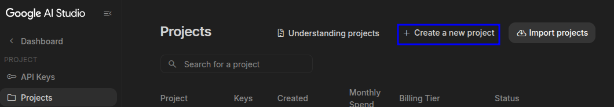
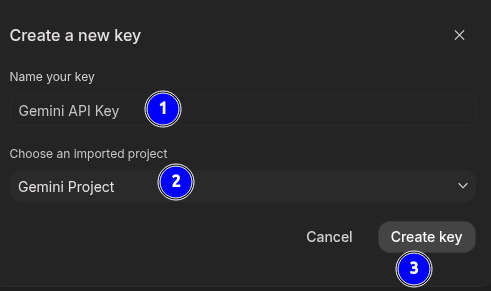
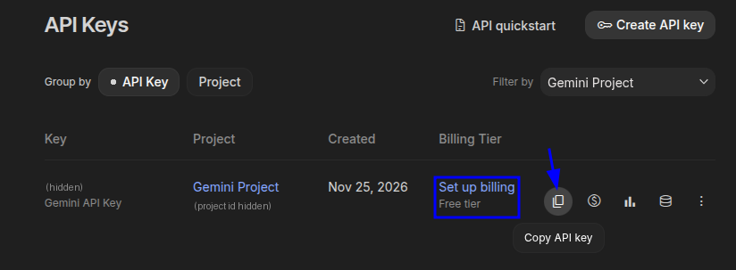
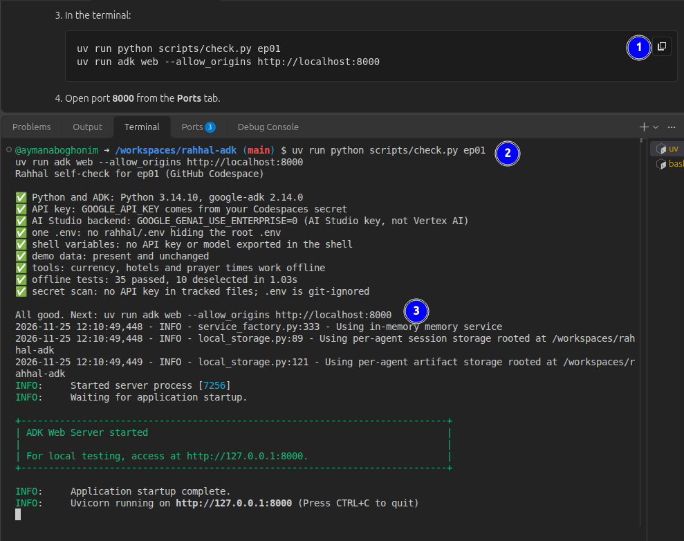
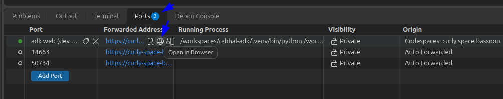

# Setup: run Rahhal on a free key

Shared by every episode: do it once. Then follow the episode's own page (for example [Episode 1](ep01/)).

<div dir="rtl">

## اللي هتحتاجه

- حساب على GitHub.
- مفتاح Gemini API مجاني من مشروع في AI Studio **من غير فوترة**.

**إزاي تجيب المفتاح المجاني:**

1. افتح صفحة المشاريع في [Google AI Studio](https://aistudio.google.com/projects) وادخل بحساب جوجل بتاعك، ودوس
   على **Create a new project**. سمّي المشروع أي اسم.

   

2. من صفحة **API Keys** دوس **Create API key**: اكتب اسم للمفتاح، واختار المشروع الجديد، ودوس **Create key**.

   

3. اتأكد إن خانة **Billing Tier** مكتوب فيها **Free tier**. متدوسش على **Set up billing**: ده اللي بيحوّل المشروع
   لمدفوع. بعد كده انسخ المفتاح من زرار النسخ.

   

4. احفظ المفتاح في مكان آمن. متحطوش في الكود، ومتشاركوش مع حد، ومتنشروش في أي صورة.

## التجهيز

الأوامر واحدة في Codespaces وعلى جهازك، مع فرق واحد بس في أمر التشغيل.

**في GitHub Codespaces:** افتح الـ codespace بـ **New with options** وحط المفتاح في خانة `GOOGLE_API_KEY`. بعد
ما التجهيز يخلص، انسخ الأمرين دول بزرار النسخ وشغّلهم في الـ terminal:

```bash
uv run python scripts/check.py ep01
uv run adk web --allow_origins http://localhost:8000
```



بعد كده افتح تبويب **Ports**، وعند المنفذ 8000 دوس على أيقونة الكرة الأرضية (Open in Browser):



**على جهازك:**

```bash
uv sync
cp .env.example .env
uv run python scripts/check.py ep01
uv run adk web
```

وحط مفتاحك في ملف `.env` قبل أمر الفحص، وبعدين افتح العنوان ده في المتصفح:

```text
http://127.0.0.1:8000
```

</div>

> [!WARNING]
> <div dir="rtl">
>
> في الـ codespace، الأمر `uv run adk web` لوحده بيفتح صفحة فاضية. تحويل المنافذ في GitHub بيبعت طلبات المتصفح
> على إنها جاية من `http://localhost:8000`، وADK بيمنع أي مصدر (origin) مش قادر يتأكد منه، علشان يحميك من مواقع
> ضارة. الخيار `--allow_origins http://localhost:8000` بيسمح بالمصدر ده بس.
>
> </div>

<div dir="rtl">

أول مرة تشغّل `adk` هيسألك سؤال عن مشاركة بيانات الاستخدام (`Enable telemetry? [Y/n]`). لو دوست Enter من غير
ما تكتب حاجة، ده معناه **موافقة**؛ اكتب حرف `n` لو مش عايز تشارك.
في كل حلقة، شغّل أمر الفحص برقم الحلقة دي (مثلًا `ep02` في الحلقة التانية).

**بعد التجهيز:** ارجع لصفحة الحلقة وكمّل منها، مثلًا [الحلقة 1](ep01/).

</div>
